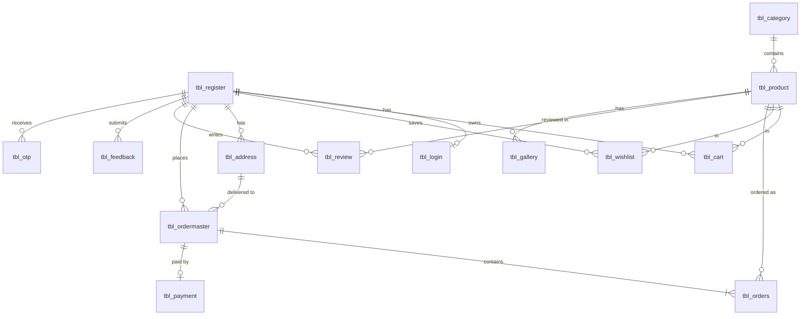

# Baby Hug – Online Baby Dresses & Accessories Website

**Consolidated project documentation** (merged from the SRS and the System Design document)

| Item | Detail |
|---|---|
| Project title | Baby Hug – Online Baby Dresses and Accessories Website |
| Prepared by | Huzna Shajahan (Roll No. 26PMC131) |
| Course | MCA – Mini Project |
| SRS version | 1.0 |
| Type | Web-based e-commerce application |
| Roles | Customer, Administrator |
| Tech stack | Python + Django, MySQL, HTML/CSS/JavaScript + Bootstrap, VS Code |
| Source documents | `SRS-Babyhug_merged.pdf`, `SYSTEM_DESIGNSORG__1___1_.pdf` |

---

## Table of Contents

1. [Project Overview](#1-project-overview)
2. [Purpose, Scope and Audience](#2-purpose-scope-and-audience)
3. [Overall Description](#3-overall-description)
4. [Functional Requirements (System Features)](#4-functional-requirements-system-features)
5. [External Interface Requirements](#5-external-interface-requirements)
6. [Non-Functional Requirements](#6-non-functional-requirements)
7. [Other Requirements](#7-other-requirements)
8. [System Design – UML Diagrams](#8-system-design--uml-diagrams)
9. [Database Design](#9-database-design)
10. [UI Forms / Screens](#10-ui-forms--screens)
11. [Inconsistencies Found Between the Two Documents](#11-inconsistencies-found-between-the-two-documents)
12. [Suggested Django Implementation Mapping](#12-suggested-django-implementation-mapping)
13. [References](#13-references)

---

## 1. Project Overview

Baby Hug is a web-based e-commerce platform for buying **baby dresses and accessories** online. Parents, guardians and other shoppers can register, browse by category, search and filter products, view details, add items to a cart or wishlist, place orders, pay online, track delivery and leave reviews. An **administrator module** lets the store owner manage products, categories, inventory, customers, orders, payments, reviews and sales reports.

**Primary objective:** provide a secure, reliable and efficient online platform that improves the shopping experience while reducing the manual effort of managing baby-product sales.

**High-level flow**

```
Customer      → Baby Hug Website → Application Server → Database
Administrator → Admin Panel      → Application Server → Database
```

---

## 2. Purpose, Scope and Audience

### 2.1 Purpose
- Let customers browse, search and buy baby dresses and accessories from anywhere.
- Give a secure, user-friendly flow: register → explore → cart → order → pay → track.
- Let administrators manage products, categories, inventory, customers, orders, payments and reviews.
- Automate online baby-product sales and improve inventory management.

### 2.2 Scope
Covers the **complete online shopping process, from customer registration to order delivery**. It is a **responsive** web app usable on modern browsers on desktops, laptops, tablets and smartphones.

### 2.3 Intended audience
| Reader | Interest |
|---|---|
| Customers | Browse, search and purchase products |
| Administrator | Manage the store and its data |
| Developers | Design, build and maintain the site |
| Testers | Verify the system meets the requirements |
| Project managers / stakeholders | Track progress against business goals |

---

## 3. Overall Description

### 3.1 Product perspective
A standalone online store with two user roles (Customer, Administrator) backed by one centralized database holding users, products, categories, inventory, carts, orders, payments and reviews.

### 3.2 Product features

**Customer features**
- Registration, login, logout, profile management
- Browse products by category; search; filter and sort; view product details
- Cart: add, update quantity, remove
- Wishlist: add, view, remove, move to cart
- Place orders, select delivery address, make online payment
- Order history, order tracking, cancel eligible orders
- Rate and review purchased products

**Administrator features**
- Secure admin login and dashboard
- Product, category, inventory and customer management
- Order management and payment monitoring
- Review moderation
- Sales and order reports

### 3.3 User classes

| Class | Description | Expected skills |
|---|---|---|
| **Customer** | Registered user who searches for and buys baby products, manages cart/wishlist/orders/profile and posts reviews | Basic computer, smartphone, browser and online-shopping knowledge |
| **Administrator** | Authorised user who controls the whole system; only authorised admins can enter the Admin module | Basic computer operations and admin functions of the website |

### 3.4 Operating environment

| Component | Technology |
|---|---|
| Operating system | Windows / Linux |
| Frontend | HTML, CSS, JavaScript, Bootstrap |
| Backend | Python, Django |
| Database | MySQL |
| Browsers | Google Chrome, Mozilla Firefox, Microsoft Edge |
| Dev environment | Visual Studio Code |
| Protocol | HTTP / HTTPS |

Client hardware: desktop, laptop, tablet or smartphone. Server hardware: a machine able to run the web app with adequate RAM, storage and network connectivity (exact sizing depends on expected users).

### 3.5 Design and implementation constraints
1. Internet connection required.
2. Only authenticated administrators can use admin functions; customers cannot.
3. Product availability depends on inventory kept by the admin.
4. Online payment depends on a payment gateway being integrated.
5. Customer, product, order and payment data must be accurate and consistent during order/payment processing.
6. Compatible with modern browsers; responsive design.
7. Passwords must **not** be stored in plain text.
8. Secure communication for sensitive information.
9. User input must be validated to reduce invalid or malicious data.

### 3.6 User documentation (planned)
- **Customer:** registration, login, browsing/searching, cart, wishlist, checkout, payment, order tracking, reviews.
- **Administrator:** login, product / category / inventory / customer / order / payment / review management, report generation.
- In-app messages and instructions should also guide users.

### 3.7 Assumptions and dependencies

**Assumptions:** customers have internet, a modern browser, valid registration/delivery details and a valid payment method (for online payment); the admin keeps product/inventory data accurate; server and database are available; admin credentials are given only to authorised people.

**Dependencies:** internet connectivity, web server, database server, Django, MySQL, web browser, payment gateway (if online payment is implemented), email/SMS services (if notifications are implemented).

---

## 4. Functional Requirements (System Features)

### 4.1 Customer registration and login
- Create a new account; collect and validate required info; prevent duplicate accounts.
- Log in with valid credentials; reject invalid ones; log out.
- Keep separate permissions for Customers and Administrators.
- Registration data: name, email, phone number, password, address.

### 4.2 Customer profile management
View profile; edit personal info; update phone, email (where permitted) and delivery address; change password; save. All data is validated before database update.

### 4.3 Product browsing and search
- View all products; browse by category; search by name or type; filter; sort by price or other options; view details.
- Product details shown: ID, name, category, description, price, image, available stock, size, colour, age group, rating, customer reviews.

### 4.4 Shopping cart management
- Add product; view cart; increase/decrease quantity; remove product.
- View per-item price, quantity, subtotal and total.
- System **verifies stock before confirming the order** and **calculates totals automatically**.

### 4.5 Wishlist management
Add, view and remove wishlist items; move an item to the cart. The wishlist is tied to the customer's account.

### 4.6 Order management
Checkout flow: proceed to checkout → select/enter delivery address → review products, quantity and total → select payment method → confirm order → complete payment → receive confirmation → view history → track status → cancel an eligible order.

**Order statuses:** `Pending → Confirmed → Processing → Shipped → Delivered` (or `Cancelled`). The administrator updates the status.

### 4.7 Payment management
- Select payment method, calculate payable total, process payment, record payment status, link payment to its order, show success/failure messages, prevent incorrect status updates.
- Possible methods: Credit/Debit Card, UPI, Net Banking, Cash on Delivery (final list depends on the gateway).

### 4.8 Order tracking
View current status, previous orders, order date, ordered products, amount and delivery information. Always shows the latest status set by the admin.

### 4.9 Product review and rating
Rate and review **purchased** products, view existing reviews, edit own review where permitted. Admin can monitor and remove inappropriate reviews.

### 4.10 Admin – product management
Add / view / edit / delete products; upload images; update price, description, stock, size, colour, age group; assign category; activate/deactivate products.

### 4.11 Admin – category management
Add / view / edit / delete (where permitted) / activate-deactivate categories.
Example categories: Baby Dresses, Baby Tops, Baby Bottoms, Baby Sets, Baby Shoes, Baby Accessories, Toys, Other Baby Products.

### 4.12 Admin – inventory management
View stock; add/update stock; monitor low-stock and out-of-stock products; update availability. **Stock reduces automatically after a successful order.**

### 4.13 Admin – customer management
View and search customers; view details and their order info; activate/deactivate accounts. Admin must **never** see passwords in plain text.

### 4.14 Admin – order management
View and search all orders; view order details, customer info, ordered products, amount and payment status; update order status; process cancellations; view completed orders.

### 4.15 Admin – payment management
View payment records, status, method and linked order; monitor successful and failed payments. Sensitive payment data must not be unnecessarily stored or exposed.

### 4.16 Admin – review management
View reviews and ratings, identify and remove inappropriate reviews, keep product feedback appropriate.

### 4.17 Admin dashboard and reports
- **Dashboard:** total customers, products, categories, orders; pending / completed / cancelled orders; total sales/revenue; low-stock products; recent orders; popular products.
- **Reports:** sales, order, customer, inventory, popular products.

---

## 5. External Interface Requirements

### 5.1 User interfaces (separate for Customer and Admin; responsive)

| Customer pages | Admin pages |
|---|---|
| Home, Registration, Login | Admin Login |
| Product Listing, Product Details | Admin Dashboard |
| Search, Category | Product Management |
| Shopping Cart, Wishlist | Category Management |
| Checkout, Payment, Order Confirmation | Inventory Management |
| My Orders, Order Tracking | Customer Management |
| Profile | Order Management |
| Review and Rating | Payment Management |
| | Review Management, Reports |

### 5.2 Hardware interfaces
No specialised hardware. Client: desktop/laptop/tablet/smartphone with internet. Server: enough CPU, RAM, storage and network.

### 5.3 Software interfaces

| Software | Purpose |
|---|---|
| Django | Backend framework |
| Python | Backend language |
| MySQL | Database |
| HTML / CSS / JavaScript | Structure, styling, client-side behaviour |
| Bootstrap | Responsive UI |
| Web browser | Access to the application |
| Payment gateway | Online payments |

### 5.4 Communication interfaces
HTTP/HTTPS for web traffic (HTTPS for sensitive data), TCP/IP for networking, internet required, secure communication during login and payment.

---

## 6. Non-Functional Requirements

### 6.1 Performance
Acceptable page-load times; fast search; handles multiple customers and high usage; optimised database operations; accurate cart/order calculations; **no duplicate orders** during transaction processing.

### 6.2 Safety
Prevent accidental data loss; regular database backups; failed payments must not create duplicate orders; keep the database consistent; errors must not corrupt order/payment records; inventory stays consistent; transaction data is recoverable after failure.

### 6.3 Security
1. Authentication for customers and administrators.
2. **Role-based access control**; customers cannot reach admin functions.
3. Secure password storage; input validation.
4. Secure session management; HTTPS.
5. Protection against **SQL injection** and **XSS**.
6. Sensitive payment info not unnecessarily stored.
7. Customer data visible only to authorised users.

### 6.4 Software quality attributes

| Attribute | Requirement |
|---|---|
| Usability | Simple interface for easy searching and buying |
| Reliability | Consistent, accurate data |
| Availability | Available whenever server and services are up |
| Maintainability | Modular structure |
| Scalability | Supports growing products, customers and orders |
| Security | Protect customer and admin data |
| Portability | Common OSes and modern browsers |
| Accuracy | Correct totals, amounts and stock |

---

## 7. Other Requirements
1. Meaningful error messages; required fields clearly marked; validate before processing.
2. Update stock after successful orders; send order confirmation; store order data for reference.
3. Admin functions restricted to authorised administrators.
4. Future support for: more payment gateways, new categories, delivery/shipment-tracking services, personalised recommendations.
5. Maintain proper database relationships and integrity.

---

## 8. System Design – UML Diagrams

### 8.1 Use case diagram
System boundary: *BabyHug – Online Store for Baby Dresses and Accessories*.

| Actor | Use cases |
|---|---|
| **Customer** | Register/Login, Browse Baby Clothes, Search Accessories, View Product Details, Manage Shopping Cart, Manage Wishlist, Place Order, Make Payment, Track Order, Cancel Order, View Order History, Submit Review |
| **Administrator** | Submit Review (linked in diagram), Manage Products, Manage Categories, Manage Inventory, Manage Customers, Manage Orders, Manage Payments, Manage Reviews, View Sales Reports |

### 8.2 Class diagram

| Class | Attributes | Methods |
|---|---|---|
| **User** | userId:int, name, email, password | login(), logout() |
| **Customer** | phone, address | browseProducts(), addToCart() |
| **Administrator** | adminLevel:int | manageProducts(), manageCategories() |
| **ShoppingCart** | cartId:int, totalAmount:double | addItem(productId, quantity), removeItem(productId) |
| **Order** | orderId, orderDate, totalAmount, status | placeOrder(), trackOrder() |
| **Payment** | paymentId, paymentDate, method, amount | makePayment(), verifyPayment() |
| **Product** | productId, name, price, stock | – |
| **Category** | categoryId, name, description | addCategory(), deleteCategory() |

**Relationships**
- `Customer` and `Administrator` specialise `User` (the diagram also draws `ShoppingCart` under `User`; see §11).
- Customer 1 — 1 ShoppingCart; Customer 1 — * Order.
- ShoppingCart 1 — Order; Order 1 — 1 Payment.
- Order * — * Product; Product * — 1 Category.
- Administrator manages Product (*) and Category (*).

### 8.3 Activity diagrams

**Customer flow**
```
Start → Already registered?
   No  → Register ─┐
   Yes → Login ◄───┘
→ User Home Dashboard → Browse/Search Baby Clothes → View Product Details → Add to Cart
→ Product already in cart? Yes → Increment quantity / No → continue
→ Proceed to Checkout → Enter delivery details → Make Payment
→ Payment successful? No → Retry / Display Failed → back to Make Payment
                       Yes → Confirm Order → Order Placed
→ Cancel order? Yes → Refund / No → continue
→ Update Order Status → Track Order → Order Delivered → Submit Review → Logout → End
```
(After "Order Placed" there is also a loop back to the Home Dashboard.)

**Admin flow**
```
Start → Login → Successful? No → Show Error → Login
                           Yes → Admin Dashboard → (parallel branches) → Logout → End

Branches:
 • Manage Products   : View Products → Add/Edit Product → Save Changes
 • Manage Categories : View Categories → Add/Edit Category → Save Changes
 • Manage Orders     : View All Orders → Update Order Status → Notify Customer
 • Manage Payments   : View Payment History → Verify Transactions
 • View Reports      : Select Report Type → Generate Sales Report
 • Manage Profile    : Update Profile → Save Profile
```

---

## 9. Database Design

Database: **MySQL**. The design lists **14 tables** in the schema summary (13 are detailed field-by-field).

### 9.1 Entity-relationship overview



### 9.2 Schema summary (as given in §2.1 of the design document)

| Table | Columns |
|---|---|
| `tbl_register` | register_id **PK**, name, email **UNIQUE**, phone, password, created_at, status |
| `tbl_login` | login_id **PK**, register_id FK→tbl_register **UNIQUE**, username **UNIQUE**, password, user_type, status, last_login |
| `tbl_category` | category_id **PK**, category_name **UNIQUE**, description, status |
| `tbl_product` | product_id **PK**, category_id FK→tbl_category, product_name, description, price, stock, size, colour, age_group, image, status, created_at |
| `tbl_cart` | cart_id **PK**, user_id FK→tbl_register, product_id FK→tbl_product, quantity, added_date |
| `tbl_wishlist` | wishlist_id **PK**, user_id FK→tbl_register, product_id FK→tbl_product, added_date |
| `tbl_ordermaster` | ordermaster_id **PK**, user_id FK→tbl_register, deliveryaddress_id FK→tbl_address, orderdate, delivery_date, total_amount, status |
| `tbl_orders` | order_id **PK**, ordermaster_id FK→tbl_ordermaster, product_id FK→tbl_product, quantity, price, subtotal |
| `tbl_address` | deliveryaddress_id **PK**, user_id FK→tbl_register, house_no, street, city, state, pincode, address_type |
| `tbl_payment` | payment_id **PK**, ordermaster_id FK→tbl_ordermaster, payment_date, payment_method, transaction_id **UNIQUE**, amount, payment_status |
| `tbl_review` | review_id **PK**, user_id FK→tbl_register, product_id FK→tbl_product, rating, review_text, review_date, status |
| `tbl_feedback` | feedback_id **PK**, user_id FK→tbl_register, subject, message, submitted_date, response, status |
| `tbl_gallery` | gallery_id **PK**, product_id FK→tbl_product, image, caption, uploaded_date |
| `tbl_otp` | otp_id **PK**, user_id FK→tbl_register, otp_code, purpose, generated_at, expires_at, status |

### 9.3 Detailed table definitions (as given in §2.2)

#### Register – customer registration details
| Field | Type | Key | Description |
|---|---|---|---|
| register_id | INT | PK | Unique registration ID |
| name | VARCHAR(100) | | Customer name |
| email | VARCHAR(100) | UNIQUE | Customer email |
| phone | VARCHAR(15) | | Contact number |
| address | TEXT | | Customer address |
| created_at | DATETIME | | Registration date |
| status | VARCHAR(20) | | Active / Blocked |

#### Login – credentials and role
| Field | Type | Key | Description |
|---|---|---|---|
| login_id | INT | PK | Unique login ID |
| register_id | INT | FK | References Register |
| username | VARCHAR(100) | UNIQUE | Username/email |
| password | VARCHAR(255) | | Password |
| user_type | VARCHAR(20) | | Customer / Admin |
| status | VARCHAR(20) | | Active / Blocked |
| last_login | DATETIME | | Last login time |

#### Category
| Field | Type | Key | Description |
|---|---|---|---|
| category_id | INT | PK | Unique category ID |
| category_name | VARCHAR(100) | | Name of category |
| description | TEXT | | Category description |
| status | VARCHAR(20) | | Active / Inactive |

#### Product
| Field | Type | Key | Description |
|---|---|---|---|
| product_id | INT | PK | Unique product ID |
| category_id | INT | FK | References Category |
| product_name | VARCHAR(200) | | Product name |
| description | TEXT | | Product description |
| price | DECIMAL(10,2) | | Product price |
| stock | INT | | Available stock |
| image | VARCHAR(255) | | Product image |
| status | VARCHAR(20) | | Available / Out of Stock |
| created_at | DATETIME | | Date added |

#### Cart
| Field | Type | Key | Description |
|---|---|---|---|
| cart_id | INT | PK | Unique cart ID |
| register_id | INT | FK | Customer ID |
| created_at | DATETIME | | Cart creation date |
| updated_at | DATETIME | | Last updated date |

#### Wishlist
| Field | Type | Key | Description |
|---|---|---|---|
| wishlist_id | INT | PK | Unique wishlist ID |
| register_id | INT | FK | Customer ID |
| product_id | INT | FK | Product ID |
| added_at | DATETIME | | Date added |

#### tbl_orders – individual items in an order
| Field | Type | Key | Description |
|---|---|---|---|
| order_id | INT | PK | Unique order (line) ID |
| ordermaster_id | INT | FK | Order master ID |
| product_id | INT | FK | Product ID |
| quantity | INT | | Quantity ordered |
| price | INT | Not Null | Price of the product |
| subtotal | INT | Not Null | Price × quantity |

#### tbl_ordermaster – main order record
| Field | Type | Key | Description |
|---|---|---|---|
| ordermaster_id | INT(11) | PK | Unique order master ID |
| register_id | INT | FK | User ID |
| address_id | INT(11) | FK | Delivery address ID |
| orderdate | DATE | Not Null | Date order placed |
| delivery_date | DATE | Not Null | Expected/delivered date |
| total_amount | INT(11) | Not Null | Total order amount |
| status | VARCHAR(30) | Not Null | Current order status |

#### Address
| Field | Type | Key | Description |
|---|---|---|---|
| address_id | INT | PK | Unique address ID |
| register_id | INT | FK | Customer ID |
| house_no | VARCHAR(50) | | House/building number |
| street | VARCHAR(150) | | Street name |
| city | VARCHAR(100) | | City |
| state | VARCHAR(100) | | State |
| pincode | VARCHAR(10) | | PIN code |
| address_type | VARCHAR(30) | | Home / Work |

#### Payment
| Field | Type | Key | Description |
|---|---|---|---|
| payment_id | INT | PK | Unique payment ID |
| order_id | INT | FK | References Order |
| payment_date | DATETIME | | Payment date |
| payment_method | VARCHAR(30) | | UPI / Card / Net Banking / COD |
| transaction_id | VARCHAR(100) | UNIQUE | Transaction ID |
| amount | DECIMAL(10,2) | | Paid amount |
| payment_status | VARCHAR(30) | | Successful / Failed / Pending |

#### Review
| Field | Type | Key | Description |
|---|---|---|---|
| review_id | INT | PK | Unique review ID |
| register_id | INT | FK | Customer ID |
| product_id | INT | FK | Product reviewed |
| rating | INT | | 1 to 5 |
| review_text | TEXT | | Customer review |
| review_date | DATETIME | | Date of review |
| status | VARCHAR(20) | | Approved / Hidden |

#### Feedback – general website/service feedback
| Field | Type | Key | Description |
|---|---|---|---|
| feedback_id | INT | PK | Unique feedback ID |
| register_id | INT | FK | Customer ID |
| subject | VARCHAR(150) | | Subject |
| message | TEXT | | Message |
| submitted_at | DATETIME | | Submission date |
| response | TEXT | | Admin response |
| status | VARCHAR(20) | | Pending / Responded |

#### Gallery – extra product images
| Field | Type | Key | Description |
|---|---|---|---|
| gallery_id | INT | PK | Unique gallery ID |
| product_id | INT | FK | References Product |
| image | VARCHAR(255) | | Image path |
| caption | VARCHAR(200) | | Image description |
| uploaded_at | DATETIME | | Upload date |

#### OTP – *listed in the schema summary only, no detailed table given*
Fields: otp_id, user_id (FK), otp_code, purpose, generated_at, expires_at, status. Presumably supports forgot-password / verification flows.

### 9.4 Status value sets used across the design

| Entity | Values |
|---|---|
| Customer / login status | Active, Blocked |
| Category status | Active, Inactive |
| Product status | Available, Out of Stock (SRS also mentions activate/deactivate) |
| Order status | Pending, Confirmed, Processing, Shipped, Delivered, Cancelled |
| Payment status | Successful, Failed, Pending |
| Payment method | UPI, Card, Net Banking, COD |
| Review status | Approved, Hidden |
| Feedback status | Pending, Responded |
| Address type | Home, Work |
| User type | Customer, Admin |

---

## 10. UI Forms / Screens

The design document includes four UI mock-ups with a minimalist black-and-white style (black primary buttons, light grey background, white cards, uppercase field labels).

| # | Screen | Elements |
|---|---|---|
| 3.1 | **Registration** | Title "Registration – Create a new account"; fields Full Name, Email, Phone, Password; black **CREATE ACCOUNT** button; "Already have an account? Log In" link |
| 3.2 | **Login** | Title "Login – Enter your credentials to continue"; Email (placeholder name@example.com), Password with **Forgot Password?** link; black **SIGN IN** button (mock-up is cropped below this) |
| 3.3 | **Add New Dress** (admin) | Auto-generated ID; Cover Image upload (JPG/PNG, max 5 MB); Dress Title; Material/Brand; SKU (`DRE-…`); Retail Price ($); Category dropdown; Description; **CANCEL** / **SAVE DRESS**; bottom nav: Products, Inventory, Sales, Settings |
| 3.4 | **User Profile Management** | Settings menu (Personal Info, Security, Notifications, Account); Personal Information (avatar with *Change Avatar*, Full Name, Email, Phone); Security (Current / New / Confirm Password); Account Preferences (Email Notifications, SMS Alerts checkboxes); **CANCEL** / **SAVE CHANGES**; bottom nav: Shop, Orders, Wishlist, Profile |

The mock-ups are mobile-first layouts (narrow, single column) and use placeholder data such as "Jane Doe" and a +1 phone number.

---

## 11. Inconsistencies Found Between the Two Documents

These are worth fixing before or during implementation.

### 11.1 Database design (schema summary vs detailed tables)

| # | Issue | Recommendation |
|---|---|---|
| 1 | **Cart structure differs.** Summary: `tbl_cart` has product_id + quantity (one row per item). Detailed: `Cart` has only cart_id/register_id/timestamps, with no item table | Use either one row per cart item, or a `Cart` header plus a `CartItem(cart_id, product_id, quantity)` table |
| 2 | **Product** detailed table lacks `size`, `colour`, `age_group`, which the SRS requires and the summary includes | Add the three fields |
| 3 | **Register** summary lacks `address`, the detailed table has it (SRS lists address at registration) while a separate Address table also exists | Keep addresses only in the Address table, or clearly define which is the "primary" one |
| 4 | **Password duplicated** in `tbl_register` (summary) and `tbl_login` | Store one password hash only (Django's `auth_user` does this) |
| 5 | **Column naming** differs: `user_id` vs `register_id`, `deliveryaddress_id` vs `address_id`, `added_date` vs `added_at`, `submitted_date` vs `submitted_at` | Pick one convention |
| 6 | **Payment FK**: summary → `ordermaster_id`; detailed → `order_id` ("References Order") | Link payment to the order master |
| 7 | **tbl_ordermaster / tbl_orders** use INT for money (price, subtotal, total_amount) while Product/Payment use DECIMAL(10,2) | Use DECIMAL(10,2) everywhere |
| 8 | `delivery_date` is **Not Null** at order time, though delivery is in the future | Make it nullable |
| 9 | `tbl_otp` has no detailed definition (14 vs 13 tables) | Add the detailed table |
| 10 | Naming: a table called `tbl_orders` holds order *items* and `tbl_ordermaster` holds the order | Consider `Order` and `OrderItem` |
| 11 | Product status is "Available / Out of Stock" but SRS needs activate/deactivate **and** out-of-stock | Add separate `is_active` flag; derive out-of-stock from `stock` |

### 11.2 UML diagrams

- **Class diagram:** `ShoppingCart` is drawn as a subclass of `User` (generalisation arrow). A cart is not a kind of user; it should be associated with `Customer` only.
- **Class diagram:** `Order` ↔ `Product` is many-to-many without an `OrderItem` class, whereas the database has `tbl_orders` for this.
- **Class diagram** omits Wishlist, Address, Review, Feedback, Gallery and OTP, which exist in the database.
- **Use case diagram:** *Submit Review* is connected to both Customer and Administrator; the admin's role is *Manage Reviews*.
- **Use case diagram** has no use cases for Wishlist-to-cart, Profile management, Forgot Password/OTP or Feedback.
- **Customer activity diagram:** "Refund" appears on cancel, but the SRS does not specify refund handling.
- **Admin activity diagram:** shows only six branches (no Customer, Inventory or Review management) and adds "Manage Profile" and "Notify Customer", which are not in the SRS.

### 11.3 UI mock-ups vs SRS

- **Registration** form has no address field (SRS says it may include address).
- **Login** uses email; the schema has a separate `username` (use email as username).
- **Add New Dress** has SKU, Material/Brand and price in **$**, but is missing Stock, Size, Colour and Age Group (all required by the SRS), and `tbl_product` has no SKU or material column. Currency should probably be ₹ for an Indian store.
- **Profile** screen includes an avatar, Notifications and SMS-alert preferences, which have no matching table columns.
- **Order tracking, cart, checkout, wishlist, product listing and admin dashboard** screens are in the SRS page list but have no mock-ups yet.

### 11.4 SRS-only or design-only items
- Feedback, Gallery, OTP (design) have no SRS requirement; consider adding "Contact/Feedback" and "Forgot Password via OTP" sections to the SRS.
- The SRS mentions email/SMS notifications only as optional dependencies.

---

## 12. Suggested Django Implementation Mapping

| Design element | Django approach |
|---|---|
| Register + Login | Use Django's built-in `User` (or a `CustomUser` extending `AbstractUser` with `phone`, `status`) and a `role`/`is_staff` flag; passwords are hashed automatically |
| Customer / Admin roles | `is_staff` / groups with permission decorators (`login_required`, `user_passes_test`) |
| Category, Product | `Category` and `Product` models with `ImageField` for images; `Product.stock`, `size`, `colour`, `age_group`, `is_active` |
| Gallery | `ProductImage` model with FK to Product |
| Cart / Wishlist | `Cart` + `CartItem`; `Wishlist` with `unique_together(user, product)` |
| Address | `Address` model, FK to user |
| Order | `Order` (master) + `OrderItem` (lines); wrap stock deduction and payment record in `transaction.atomic()` |
| Payment | `Payment` model, OneToOne with `Order`; unique `transaction_id` |
| Review | `Review` with rating validators 1–5; allow only for purchased products |
| Feedback / OTP | `Feedback` and `PasswordOTP` models with `expires_at` |
| Admin module | Custom admin dashboard views (or customise Django admin) with aggregate queries for dashboard counts and reports |
| Security | Django CSRF, ORM (prevents SQL injection), template auto-escaping (XSS), `SESSION_COOKIE_SECURE`, HTTPS |
| Database | MySQL via `mysqlclient` in `settings.py` |

**Suggested build order:** authentication (register / login / forgot password) → categories and products (admin) → product listing, search and details → cart and wishlist → checkout, address and order → payment → order tracking and cancellation → reviews → admin dashboard and reports → polish and testing.

---

## 13. References

1. IEEE Std 29148-2018 – Systems and Software Engineering – Requirements Engineering
2. Django Official Documentation
3. MySQL Official Documentation
4. Bootstrap Documentation
5. MDN Web Docs
6. Visual Studio Code Documentation
7. Software engineering textbooks and online resources
